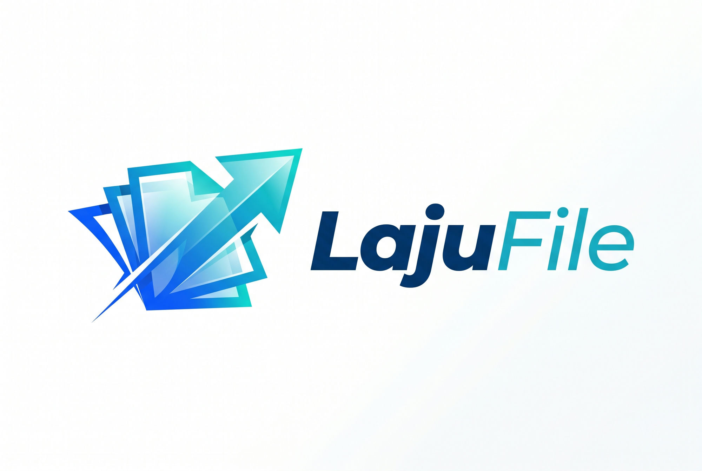

<p align="center">
  
</p>

<h1 align="center">LajuFile</h1>
<p align="center">A fast, native download manager for Windows and Linux — built in Rust.</p>

> **Status:** Milestones 1–6 and IDM-style workflow parity are implemented:
> segmented downloads, true resume, queues, global speed limits, local bridge +
> Chromium MV3 extension (Google Chrome, Brave, Microsoft Edge), YouTube video
> downloads (`yt-dlp` + `ffmpeg`), IDM-style `Download File Info` capture
> dialog, per-connection `Download Progress` window, and `Download Complete`
> prompt.

## Why LajuFile

LajuFile is a personal project: a desktop download manager that keeps the
essentials of a classic download manager — segmented transfers, pause and
resume, queues, speed limits, and browser capture — in a small native
application. It is inspired by Internet Download Manager, but uses original
code and design.

## What works today

- Native egui window with a download table, sidebar filters, and a context menu.
- Add URL with metadata probe, file naming, and active duplicate detection.
- Choose the save folder per download (Browse in Add), with an optional
  "Ask where to save each download" prompt.
- Segmented downloads with up to 32 parallel byte ranges.
- True resume using `If-Range`; without a validator, a 64 KiB prefix check.
- Queue with a configurable simultaneous-download limit.
- Global speed limit in KB/s (`0` means unlimited).
- Pause, resume, remove, pause all, and resume all.
- Tray icon: show, add URL, pause all, resume all, exit; close to tray.
- Settings for save folder, concurrency, connections, speed, theme, and close-to-tray.
- Light and dark themes.
- Persistent state in `%APPDATA%\LajuFile`; SQLite in WAL mode with per-segment progress.
- Probe uses `Range: bytes=0-0`; downloads use `Accept-Encoding: identity`.
- Downloads write to `<final>.lajufile`, are size-checked, and are finalized without overwriting an existing file.
- Windows-safe file names, duplicate-name handling, and reserved-device protection.
- Local bridge at `127.0.0.1:53841` with token authentication, CORS, and a 64 KiB body limit.
- `GET /health` and `POST /downloads` for browser integrations.
- Browser capture (Google Chrome, Brave, Microsoft Edge, and other Chromium browsers) through `onDeterminingFilename`, with an `onCreated` fallback and a "Download with LajuFile" link menu.
- Browser cookies are stored encrypted per-user (Windows DPAPI on Windows, `0600` user key on Linux), never as plaintext.
- Capture settings in the app: status, port, token copy/regenerate, and Test connection.
- YouTube downloads through managed `yt-dlp` + `ffmpeg` (with automatic H.264/AAC `.mp4` audio compatibility), plus an IDM-style floating **"Unduh video ini"** bar and quality dropdown (`1080p HD 60 fps`, `720p HD`, `Audio only`, etc.) on YouTube watch pages.
- IDM-style toolbar (`Add URL`, `Batch`, `Resume`, `Stop`, `Stop All`, `Delete`, `Delete Completed`, `Options`), `Tasks` menu, and graphical file-type icons (`MP4`, `PDF`, `EXE`, `ZIP`, `MP3`, `JPG`, `BIN`, `FILE`) in the download list.
- Clipboard Monitor (`Ctrl+C` auto-opens `Add Download` for downloadable file & YouTube links), Batch Download / Text Import (URL list + wildcard pattern `*` generator + `.txt` import), and `Launch LajuFile on Windows startup`.
- Embedded Windows PE application icon, product name (`LajuFile`), and publisher metadata (`Nuel Wallep`).
- IDM-style `Download File Info` dialog on browser capture with probed file size, editable file name (auto-updating category), `Start download`, and `Download later`.
- IDM-style `Download Progress` window (double-click active/paused row) with per-connection/segment progress table (`N.`, `Downloaded`, `Progress`, `Info`) and `Download Complete` prompt.

## Browser capture (Google Chrome, Brave, Microsoft Edge)

1. Start LajuFile and open **Settings → Browser capture**. Copy the port and token.
2. Open your browser's extensions page:
   - **Google Chrome:** `chrome://extensions`
   - **Brave:** `brave://extensions`
   - **Microsoft Edge:** `edge://extensions`
3. Enable **Developer mode**, choose **Load unpacked**, and select the `extension/` folder.
4. Open the LajuFile Capture extension options and paste the port and token.
5. Click **Test connection**; the popup should show **Connected**.

The extension sends downloads to the local bridge:

- `201 Created` — LajuFile accepted the download and returns its id, filename, and size.
- `409 Conflict` — the URL is already active in LajuFile; the browser copy is cancelled.
- `422 Unprocessable Entity` — the probe failed; no LajuFile record is created.
- `401 Unauthorized` — the token does not match; the browser download continues.

The bridge only listens on localhost. The token is copied from Settings and can
be regenerated there; the old token stops working immediately. A port change
applies after restarting LajuFile.

### Capture limitations

- POST and form submissions are not captured.
- `blob:` URLs, DRM-protected media, and one-time URLs are not supported.
- Downloads started before LajuFile is running are not captured.
- Cookies are forwarded only for the original URL; cross-host redirect cookies are not supported.
- The popup has no "Open LajuFile" action because no protocol handler is registered yet.
- Edge may briefly show its download shelf before LajuFile cancels the browser copy.
- Pause persists progress at roughly one-second granularity.

## Video downloads

1. Paste a YouTube link in **Add download**; a **Video quality** row appears.
2. Click **Load qualities** to list the heights yt-dlp reports for that video,
   then pick one (or leave **Best available**).
3. Add the link as usual. The job joins the same queue, so pause, resume, and
   remove work exactly like an HTTP download.

LajuFile downloads two tools into `%APPDATA%\LajuFile\tools` on first use:
`yt-dlp.exe` (the release binary from GitHub) and `ffmpeg.exe` (from the
gyan.dev essentials build). yt-dlp merges the chosen video stream with the best
audio through ffmpeg, so a merged file needs both. The button on a YouTube watch
page in the Edge extension does the same through `POST /video` and
`POST /video/formats`.

A video row is stored with `kind = video` and the yt-dlp selector it will use.
Cancel and remove kill the child process and delete the partial file.

### Video limitations

- Single videos only: no playlists, no channels, no subtitles.
- DRM-protected, members-only, and age-restricted videos fail with the yt-dlp
  error message; browser cookies are not forwarded to yt-dlp.
- A height the video does not offer falls back to the best lower one.
- The downloaded file is always `.mp4`, whatever the source container.

## Roadmap

- [x] **M1 — Foundation:** store, probe, naming, single-stream download.
- [x] **M2 — Desktop app:** GUI, queue, tray, themes.
- [x] **M3 — Engine:** segmented downloads, true resume, global speed limit.
- [x] **M4 — Capture:** local bridge and Edge MV3 extension.
- [x] **M5 — Release:** hardening, docs, packaging.
- [x] **M6 — YouTube:** managed yt-dlp + ffmpeg, quality list, video jobs.

## Build

Requirements:
- **Windows 10/11 x64:** Rust stable with the MSVC toolchain, and Visual Studio Build Tools with the C++ workload.
- **Linux x64 (Ubuntu/Debian):** Rust stable and `sudo apt-get install -y libgtk-3-dev libxcb-render0-dev libxcb-shape0-dev libxcb-xfixes0-dev libxkbcommon-dev libssl-dev libayatana-appindicator3-dev libxdo-dev pkg-config`.

```powershell
cargo test
cargo run -p lajufile-app
cargo build --release -p lajufile-app
```

### Release

Pushing a tag builds and publishes portable archives for both **Windows** (`LajuFile-<tag>-windows-x64.zip`) and **Linux** (`LajuFile-<tag>-linux-x64.tar.gz`) on the GitHub release page:

```powershell
git tag v0.1.0
git push origin v0.1.0
```

Each archive holds the `lajufile` executable (`lajufile.exe` on Windows, `lajufile` on Linux), the `extension/` folder (load unpacked in Chrome, Brave, or Edge), `README.md`, and `LICENSE`.

The app resumes downloads that were interrupted by a crash: rows left in
`Downloading` come back as queued (or paused when auto-resume is off) and
continue from their stored segment offsets.


## Design

- Figma: <https://www.figma.com/design/PASDzAEqJlF35dkv4L9eIx>
- Spec: [`docs/superpowers/specs/2026-11-14-lajufile-design.md`](docs/superpowers/specs/2026-11-14-lajufile-design.md)
- Milestone 1 plan: [`docs/superpowers/plans/2026-11-14-lajufile-milestone-1-foundation.md`](docs/superpowers/plans/2026-11-14-lajufile-milestone-1-foundation.md)
- Milestone 2 plan: [`docs/superpowers/plans/2026-11-14-lajufile-milestone-2-gui-tray.md`](docs/superpowers/plans/2026-11-14-lajufile-milestone-2-gui-tray.md)
- Milestone 3 plan: [`docs/superpowers/plans/2026-11-15-lajufile-milestone-3-engine.md`](docs/superpowers/plans/2026-11-15-lajufile-milestone-3-engine.md)
- Milestone 4 plan: [`docs/superpowers/plans/2026-11-15-lajufile-milestone-4-bridge-extension.md`](docs/superpowers/plans/2026-11-15-lajufile-milestone-4-bridge-extension.md)

## License

MIT — see [LICENSE](LICENSE).
